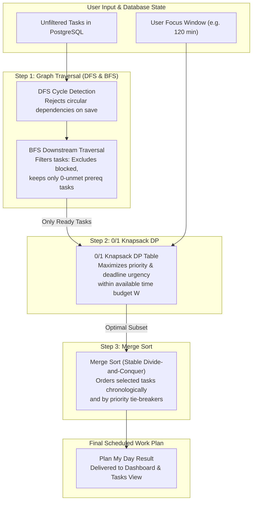

# How DSA Powers Chronos — Core Algorithmic Architecture

> **University Syllabus Mapping**:
> - **Unit I, Chapter 1.2**: Sorting Techniques (Merge Sort)
> - **Unit III, Chapter 3.1**: Graph Traversal (Breadth-First Search & Depth-First Search)
> - **Unit III, Chapter 3.3**: Dynamic Programming (0/1 Knapsack Problem)

This document provides a technical deep-dive into the three foundational Data Structures and Algorithms (DSA) systems that power **Chronos**. These algorithms are not isolated academic examples; they execute directly within the backend scheduling engine, determining event timelines, validating prerequisite task graphs, and calculating optimal daily work plans.

---

## 1. Merge Sort (Unit I, Chapter 1.2 — Sorting Techniques)

### 1.1 Scheduling Problem Solved in Chronos
In an event and task scheduler, records originate from multiple disparate sources: user-created calendar events, recurring meetings, and task due dates with differing priorities. 
Without deterministic and stable ordering:
1. Calendar feeds display chronological anomalies where concurrent or adjacent events flip positions between page reloads.
2. Ties between records sharing identical timestamps or priority ratings break unpredictably, degrading user trust.

Chronos requires **guaranteed stable $O(n \log n)$ ordering** with deterministic tie-breakers:
- **Calendar Feed**: Primary sort on `startTime ASC`, secondary sort on `endTime ASC`, tertiary tie-breaker on `title ASC`.
- **Task Backlog**: Primary sort on `priority DESC` (`URGENT` > `HIGH` > `MEDIUM` > `LOW`), secondary sort on `dueDate ASC`, tertiary tie-breaker on `createdAt ASC`.

### 1.2 Why Merge Sort & Stability
A sorting algorithm is **stable** if two objects with equal keys appear in the same relative order in the sorted output as they appeared in the input array.
- In Chronos, a user may filter tasks by category and then sort by deadline. Stability ensures that tasks with identical deadlines preserve their existing user-arranged relative order.
- Merge Sort guarantees $O(n \log n)$ time in the worst case, unlike Quick Sort which degenerates to $O(n^2)$ on already-sorted or reverse-sorted lists.

### 1.3 Implementation & Calling Code
- **Source File**: [`server/src/dsa/MergeSort.ts`](file:///c:/Users/gupta/Downloads/ads%20project/server/src/dsa/MergeSort.ts)
- **Calling Modules**:
  - `server/src/controllers/calendarController.ts#L48`: Sorts the unified event and deadline feed.
  - `server/src/controllers/taskController.ts#L32`: Orders the task backlog for Kanban and list views.
  - `server/src/services/schedulerService.ts#L52`: Sorts ready candidate tasks for execution planning.
- **Verification Tests**: `server/src/tests/dsa.test.ts` (Edge cases: empty array, single element, duplicates, reverse-sorted, pre-sorted, custom object comparators).

### 1.4 Formal Pseudocode
```typescript
function mergeSort<T>(items: T[], comparator: (a: T, b: T) => number): T[] {
    if (items.length <= 1) return items.slice();

    const mid = Math.floor(items.length / 2);
    const left = mergeSort(items.slice(0, mid), comparator);
    const right = mergeSort(items.slice(mid), comparator);

    return merge(left, right, comparator);
}

function merge<T>(left: T[], right: T[], comparator: (a: T, b: T) => number): T[] {
    const result: T[] = [];
    let i = 0, j = 0;

    // Preserve stability: if elements are equal (comparator <= 0), take from left
    while (i < left.length && j < right.length) {
        if (comparator(left[i], right[j]) <= 0) {
            result.push(left[i++]);
        } else {
            result.push(right[j++]);
        }
    }

    while (i < left.length) result.push(left[i++]);
    while (j < right.length) result.push(right[j++]);

    return result;
}
```

### 1.5 Worked Example
Consider 4 calendar events to sort:
```
E1: 10:00 - 11:00 ("Sprint Planning")
E2: 09:00 - 10:00 ("Standup")
E3: 10:00 - 10:30 ("Quick Sync")
E4: 09:00 - 10:00 ("Architecture Check")
```
1. **Divide**:
   - Left: `[E1, E2]`, Right: `[E3, E4]`
   - Sub-dividing yields `[E1]`, `[E2]`, `[E3]`, `[E4]`.
2. **Merge Sub-arrays**:
   - Merge `[E1]` and `[E2]`: `E2 (09:00)` < `E1 (10:00)` $\to$ `[E2, E1]`.
   - Merge `[E3]` and `[E4]`: `E4 (09:00)` < `E3 (10:00)` $\to$ `[E4, E3]`.
3. **Final Merge with Secondary Tie-Breaker**:
   - Compare `E2 (09:00, "Standup")` vs `E4 (09:00, "Architecture Check")`. Start times are equal. Secondary comparator checks title alphabetically: `"Architecture Check"` precedes `"Standup"`.
   - Result: `[E4, E2, E3, E1]`.

### 1.6 Asymptotic Complexity
| Metric | Complexity | Explanation |
| :--- | :--- | :--- |
| **Best Case Time** | $\mathcal{O}(n \log n)$ | Array is divided into $\log_2 n$ levels; merging takes linear time at each level. |
| **Average Case Time** | $\mathcal{O}(n \log n)$ | Recurrence relation $T(n) = 2T(n/2) + \Theta(n)$ solves to $\Theta(n \log n)$ via Master Theorem. |
| **Worst Case Time** | $\mathcal{O}(n \log n)$ | Independent of initial element ordering. |
| **Auxiliary Space** | $\mathcal{O}(n)$ | Temporary sub-arrays allocated during the merge step. |

---

## 2. Graph Traversal: BFS & DFS (Unit III, Chapter 3.1 — Graph Traversal)

### 2.1 Scheduling Problem Solved in Chronos
In complex project planning, tasks frequently have prerequisites (e.g., *"Deploy Backend"* cannot start until *"Run Database Migrations"* completes). 
Prerequisite networks are modeled as a **Directed Acyclic Graph (DAG)**:
- **Vertices ($V$)**: Individual tasks.
- **Directed Edges ($E$)**: Dependency relationships where directed edge $(u \to v)$ signifies that task $u$ depends on task $v$ ($v$ must complete before $u$ can start).

Two critical problems arise:
1. **Deadlock Prevention**: If task A depends on task B, and task B depends on task A ($A \to B \to A$), neither can ever execute. Chronos must reject circular edges before saving them to the database.
2. **Readiness Cascades**: When a user marks task $v$ as `COMPLETED`, which downstream dependent tasks are now unlocked and ready to start?

### 2.2 Algorithm Implementations
Chronos uses two graph traversal techniques:

#### A. Depth-First Search (DFS) for Cycle Rejection
Before creating a dependency $(u \to v)$ in PostgreSQL, DFS traverses the graph starting from proposed prerequisite $v$. If the traversal reaches $u$, adding the edge would form a closed cycle.
- Uses **3-Color Marking**:
  - `0 = WHITE`: Node unvisited.
  - `1 = GRAY`: Node currently in active recursive stack.
  - `2 = BLACK`: Node and all reachable descendants fully processed.
- If a directed edge points to a `GRAY` node, a back-edge is detected $\to$ **Cycle Rejected**.

#### B. Breadth-First Search (BFS) for Downstream Readiness Cascades
When task $v$ completes, BFS traverses downstream dependent tasks level by level:
1. Enqueues direct dependents of $v$.
2. For each dependent $u$, inspects whether all its prerequisites in $G$ are now marked `COMPLETED`.
3. If all prerequisites are satisfied, $u$ is categorized as **`newlyReady`**.
4. If one or more prerequisites remain pending, $u$ is categorized as **`stillBlocked`**.
5. Traversal continues to next downstream layer.

### 2.3 Implementation & Calling Code
- **Source File**: [`server/src/dsa/DependencyGraph.ts`](file:///c:/Users/gupta/Downloads/ads%20project/server/src/dsa/DependencyGraph.ts)
  - `wouldCreateCycle(taskId, dependsOnTaskId)`: 3-color DFS cycle validation.
  - `traverseDownstreamBfs(completedTaskId, allCompletedIds)`: BFS readiness cascade calculation.
  - `topologicalSortBfs()`: Kahn's in-degree zero algorithm computing concurrent execution tiers.
- **Calling Modules**:
  - `server/src/controllers/taskController.ts#L170`: Rejects circular edges in `POST /api/tasks/:id/dependencies`; triggers downstream impact on `PATCH /api/tasks/:id`.
  - `server/src/controllers/schedulerController.ts#L54`: Powers `GET /api/scheduler/impact/:taskId`.
- **Verification Tests**: `server/src/tests/dsa.test.ts` (Cycle detection on 2-node and 3-node loops, BFS cascade verification, topological tiers).

### 2.4 Formal Pseudocode

#### DFS Cycle Detection
```typescript
function wouldCreateCycle(taskId: string, dependsOnTaskId: string): boolean {
    if (taskId === dependsOnTaskId) return true; // Self-loop

    // Hypothetically add edge and inspect for back-edge reachable from dependsOnTaskId
    const color = new Map<string, number>(); // 0: WHITE, 1: GRAY, 2: BLACK

    function hasCycleDfs(u: string): boolean {
        color.set(u, 1); // GRAY

        for (const v of getDependencies(u)) {
            const vColor = color.get(v) || 0;
            if (vColor === 1) return true; // Back-edge found!
            if (vColor === 0 && hasCycleDfs(v)) return true;
        }

        color.set(u, 2); // BLACK
        return false;
    }

    return hasCycleDfs(dependsOnTaskId);
}
```

#### BFS Downstream Readiness Cascade
```typescript
function traverseDownstreamBfs(completedId: string, completedSet: Set<string>): CascadeResult {
    const queue: string[] = [];
    const visited = new Set<string>();
    const newlyReady: string[] = [];
    const stillBlocked: string[] = [];

    // Enqueue direct downstream dependents
    for (const dep of getDependents(completedId)) {
        queue.push(dep);
        visited.add(dep);
    }

    while (queue.length > 0) {
        const curr = queue.shift()!;
        const prereqs = getPrerequisites(curr);
        const unmet = prereqs.filter(p => !completedSet.has(p));

        if (unmet.length === 0) {
            newlyReady.push(curr);
        } else {
            stillBlocked.push(curr);
        }

        for (const next of getDependents(curr)) {
            if (!visited.has(next)) {
                visited.add(next);
                queue.push(next);
            }
        }
    }

    return { newlyReady, stillBlocked };
}
```

### 2.5 Worked Example
Consider 4 tasks:
```
T1: "Database Schema"
T2: "API Endpoints" (depends on T1)
T3: "Auth Middleware" (depends on T1)
T4: "Frontend Integration" (depends on T2 and T3)
```
1. **Cycle Prevention Test**: User attempts to make `T1` depend on `T4`.
   - DFS initiates from `T4` $\to$ reaches `T2` and `T3` $\to$ reaches `T1`.
   - A back-edge to `T1` is identified; API returns `400 Bad Request` with message: *"Circular dependency detected (T1 -> T4 -> T2 -> T1)"*.
2. **Completion Cascade**: User marks `T1` as `COMPLETED`.
   - `queue = [T2, T3]`.
   - Processing `T2`: Prerequisite `T1` is completed $\to$ `T2` is **newly ready**.
   - Processing `T3`: Prerequisite `T1` is completed $\to$ `T3` is **newly ready**.
   - Next layer: `T4` is enqueued. But `T4` still requires `T2` and `T3` $\to$ categorized as **still blocked**.

### 2.6 Asymptotic Complexity
| Operation | Time Complexity | Auxiliary Space | Explanation |
| :--- | :--- | :--- | :--- |
| **DFS Cycle Check** | $\mathcal{O}(V + E)$ | $\mathcal{O}(V)$ | Visits each reachable vertex and traverses its adjacency list once. Call stack depth $\le V$. |
| **BFS Downstream Cascade** | $\mathcal{O}(V + E)$ | $\mathcal{O}(V)$ | Queue stores up to $V$ vertices; visited set avoids re-traversing multi-path DAG nodes. |
| **Graph Adjacency Storage** | — | $\mathcal{O}(V + E)$ | Maintained in dual adjacency hash maps: `forwardAdj` and `reverseAdj`. |

---

## 3. 0/1 Knapsack with Dynamic Programming (Unit III, Chapter 3.3)

### 3.1 Scheduling Problem Solved in Chronos
Users frequently face a bounded amount of focused work time in a day (e.g., 2 hours before a meeting). They have a backlog of ready tasks, each requiring an estimated duration in minutes and having varying urgency/priority levels.
- **Problem**: Picking tasks greedily by highest priority can waste time (a 90-minute task might prevent two 45-minute urgent tasks from completing).
- **Solution**: The **0/1 Knapsack Problem** models this optimization mathematically. Chronos computes the subset of tasks that yields the **maximum total value** without exceeding the user's available time capacity $W$.

### 3.2 Mapping Chronos Domain to 0/1 Knapsack
| Knapsack Parameter | Chronos Domain Concept | Units / Values |
| :--- | :--- | :--- |
| **Capacity ($W$)** | User's available daily focus budget | Minutes ($15 \le W \le 720$) |
| **Item Weight ($w_i$)** | Estimated task duration | Minutes ($10 \le w_i \le W$) |
| **Item Value ($v_i$)** | Urgency & Priority Score | Deterministic integer metric: |
| | - Priority weight: `URGENT` $= 100$, `HIGH` $= 60$, `MEDIUM` $= 30$, `LOW` $= 10$ | |
| | - Proximity bonus: $+50$ if due within 24h, $+25$ if due within 48h, $+10$ if due within 7 days | |
| **Eligibility Filter** | Prerequisite Gate | Only tasks with **0 unmet prerequisites** are considered. Blocked tasks are excluded. |

### 3.3 Dynamic Programming Recurrence
Let $dp[i][w]$ represent the maximum value attainable using a subset of the first $i$ tasks with a time capacity limit $w$:

$$\forall i \in \{1, \dots, n\}, \quad \forall w \in \{0, \dots, W\}:$$

$$dp[i][w] = \begin{cases} 
dp[i-1][w] & \text{if } w_i > w \\ 
\max\Big(dp[i-1][w],\; dp[i-1][w - w_i] + v_i\Big) & \text{if } w_i \le w 
\end{cases}$$

Base cases:
$$dp[0][w] = 0 \quad \forall w, \qquad dp[i][0] = 0 \quad \forall i$$

### 3.4 Implementation & Calling Code
- **Source File**: [`server/src/dsa/KnapsackDP.ts`](file:///c:/Users/gupta/Downloads/ads%20project/server/src/dsa/KnapsackDP.ts)
  - `calculateTaskValue(priority, dueDate, now)`: Computes deterministic value $v_i$.
  - `planDay(candidates, availableMinutes, now)`: Constructs 2D DP table and backtracks the selected task subset.
- **Calling Modules**:
  - `server/src/controllers/schedulerController.ts#L38`: Serves `POST /api/scheduler/plan-my-day` and `GET /api/scheduler/plan-my-day`.
  - UI Consumer: `client/src/components/planner/PlanMyDayModal.tsx` and `DashboardPage.tsx`.
- **Verification Tests**: `server/src/tests/dsa.test.ts` (Empty candidate handling, tasks exceeding capacity, exact fit, optimal subset selection under tight constraints).

### 3.5 Formal Pseudocode
```typescript
function planDay(candidates: Task[], capacity: number): DayPlanResult {
    const n = candidates.length;
    const items = candidates.map(t => ({
        task: t,
        weight: Math.max(10, t.durationMinutes || 30),
        value: calculateTaskValue(t.priority, t.dueDate)
    }));

    // 1. Build DP Table
    const dp: number[][] = Array.from({ length: n + 1 }, () => new Array(capacity + 1).fill(0));

    for (let i = 1; i <= n; i++) {
        const { weight, value } = items[i - 1];
        for (let w = 0; w <= capacity; w++) {
            if (weight <= w) {
                dp[i][w] = Math.max(dp[i - 1][w], dp[i - 1][w - weight] + value);
            } else {
                dp[i][w] = dp[i - 1][w];
            }
        }
    }

    // 2. Backtrack to Reconstruct Selected Subset
    const selected: Task[] = [];
    let currentWeight = capacity;

    for (let i = n; i > 0 && currentWeight > 0; i--) {
        if (dp[i][currentWeight] !== dp[i - 1][currentWeight]) {
            const item = items[i - 1];
            selected.push(item.task);
            currentWeight -= item.weight;
        }
    }

    // 3. Stably order selected tasks via Merge Sort for execution
    const ordered = MergeSort.sort(selected, (a, b) => compareTasks(a, b));

    return {
        selectedTasks: ordered,
        totalPlannedMinutes: capacity - currentWeight,
        remainingMinutes: currentWeight,
        summaryReason: `Planned ${capacity - currentWeight} of ${capacity} minutes, focusing on closest deadlines.`
    };
}
```

### 3.6 Worked Example
User has **$W = 90$ minutes** available. Candidate eligible tasks:
```
T1: "Write Docs"       (w1 = 30m, v1 = 40)
T2: "Fix Security Bug"  (w2 = 60m, v2 = 90)
T3: "Refactor Styles"   (w3 = 60m, v3 = 50)
```

**DP Table Construction**:
| $i$ \ $w$ | 0m | 30m | 60m | 90m |
| :--- | :---: | :---: | :---: | :---: |
| **0 (No items)** | 0 | 0 | 0 | 0 |
| **1 (T1: 30m, 40v)** | 0 | 40 | 40 | 40 |
| **2 (T2: 60m, 90v)** | 0 | 40 | 90 | **130** (40 + 90) |
| **3 (T3: 60m, 50v)** | 0 | 40 | 90 | **130** ($\max(130, 0 + 50)$) |

**Backtracking**:
- At $i=3, w=90$: $dp[3][90] = 130 == dp[2][90] \implies$ `T3` not selected.
- At $i=2, w=90$: $dp[2][90] = 130 \ne dp[1][90] (40) \implies$ `T2` **selected**! $w = 90 - 60 = 30$.
- At $i=1, w=30$: $dp[1][30] = 40 \ne dp[0][30] (0) \implies$ `T1` **selected**! $w = 30 - 30 = 0$.

**Output**:
- Selected: `[T2, T1]`
- Total Planned Time: $60 + 30 = 90$ minutes (100% capacity utilization)
- Total Value: $90 + 40 = 130$ (optimal)

### 3.7 Asymptotic Complexity
| Metric | Complexity | Explanation |
| :--- | :--- | :--- |
| **Time Complexity** | $\mathcal{O}(n \cdot W)$ | Table of dimensions $(n+1) \times (W+1)$ is filled with constant-time inner loop operations. |
| **Auxiliary Space** | $\mathcal{O}(n \cdot W)$ | 2D table storing optimal subproblem values for subset reconstruction. |
| **Practical Bounds** | $< 1.5\text{ ms}$ | With typical limits $n \le 100$ and $W \le 720$, table cells $\le 72,000$, executing in sub-millisecond time in Node.js. |

---

## 4. Synthesis & Cross-Algorithm Flow


