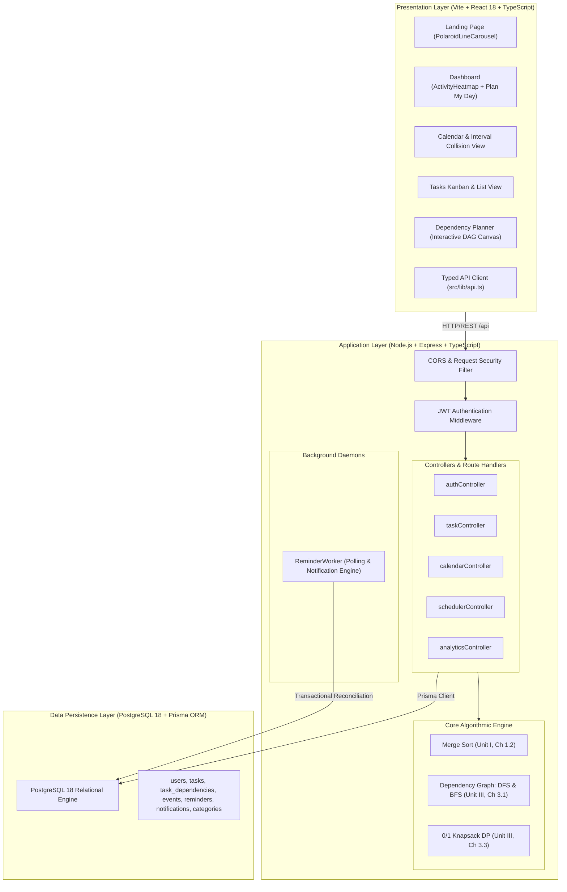

# Chronos — System Architecture Specification

## 1. High-Level Architecture Overview

Chronos is structured as a **modern, decoupled three-tier client-server application**:

---

## 2. Presentation Layer (Frontend)

### 2.1 Technology Stack & Conventions
- **Framework**: React 18 with TypeScript 5, bundled via Vite.
- **Styling**: Tailwind CSS with custom CSS variables, CSS modules, and custom motion tokens.
- **Iconography**: Lucide React.
- **Client Routing**: React Router v6 with `ProtectedRoute` guards for authenticated workspace areas.

### 2.2 Component Hierarchy
- `AppShell.tsx`: Global authenticated layout featuring the persistent top navigation bar, quick creation modal (`QuickCreateModal.tsx`), notification polling bell, and responsive sidebar.
- `DashboardPage.tsx`: Primary executive dashboard featuring the **Activity Heatmap**, **Recommended Next Task**, productivity summary stats, and one-click access to **Plan My Day**.
- `CalendarPage.tsx`: Visual timeline displaying Merge-Sorted calendar events and deadline milestones, with overlap warning alerts and available continuous focus gaps.
- `TasksPage.tsx`: Backlog workspace supporting three view modes:
  1. **Kanban Board**: Drag-and-drop / column-based stages (`TODO`, `IN_PROGRESS`, `COMPLETED`).
  2. **List View**: Dense tabular listing with quick status transitions.
  3. **Dependency Planner**: Interactive full-canvas DAG visualization.
- `DependencyPlanner.tsx`: Graph canvas featuring pan and zoom controls, draggable task nodes, live prerequisite handles, and cycle validation.
- `PlanMyDayModal.tsx`: Focus planning modal allowing users to enter available time (30m to 12h) to generate an optimal daily plan using 0/1 Knapsack Dynamic Programming.

### 2.3 Bespoke UI Integrations
1. **Activity Heatmap (`client/src/components/ui/activity-heatmap.tsx`)**:
   - Implements a GitHub-style activity contribution grid.
   - Powered by real database completions from `GET /api/analytics/activity`.
   - Contiguous day sequence, oldest first, zero-filled for missing dates.
   - Interactive 90-day / 365-day range switcher with responsive cell tooltips and date-selection inspector callbacks.
2. **Polaroid Line Carousel (`client/src/components/ui/polaroid-line-carousel.tsx`)**:
   - Featured prominently on the public landing page.
   - Employs physics-based sagging clothesline curves with spring dampening and rotation mechanics.

---

## 3. Application Layer (Backend API Service)

### 3.1 Framework & Architecture
- **Runtime**: Node.js v24 LTS with TypeScript (`ts-node` for development, `tsc` for production compile).
- **Web Framework**: Express 4 with modular routers mounted under `/api`.
- **Security & Middleware**:
  - `cors`: Strict allowed-origin verification for `http://chronos.localhost:3456`.
  - `requireAuth`: Stateless JWT verification extracting `req.user` payload.
  - `errorHandler`: Centralized error interceptor mapping domain exceptions (`CycleError`, `ValidationError`, `PrismaClientKnownRequestError`) to HTTP status codes.

### 3.2 Service Layer & Algorithmic Integration
- **`calendarController.ts` & `calendarService.ts`**:
  - Pulls events and tasks within a date range from PostgreSQL.
  - Invokes `MergeSort.sort()` with deterministic tie-breakers to return an orderly feed.
  - Uses `IntervalSweep.detectCollisions()` to identify overlapping commitments.
- **`taskController.ts` & `taskService.ts`**:
  - Handles task CRUD with ownership isolation (`userId` checks).
  - On adding a prerequisite: invokes `DependencyGraph.wouldCreateCycle()` via recursive 3-color DFS to reject circular dependencies before database write.
  - On marking a task completed: invokes `DependencyGraph.traverseDownstreamBfs()` to compute downstream readiness cascades.
- **`schedulerController.ts` & `schedulerService.ts`**:
  - Exposes `POST /api/scheduler/plan-my-day`.
  - Filters out blocked tasks (unmet prerequisites > 0).
  - Invokes `KnapsackDP.planDay()` to construct the 2D DP table and backtrack the optimal task subset within user time capacity $W$.
- **`reminderWorker.ts`**:
  - Autonomous background daemon running every 30 seconds.
  - Queries pending reminders due for delivery (`remindAt <= NOW()`).
  - Transactionally dispatches notifications and marks reminders `SENT` with idempotent recovery.

---

## 4. Data Layer (Relational Persistence)

- **Database Engine**: PostgreSQL 18 running on port `5433` (cluster at `C:\Users\gupta\.chronos_pg_data`).
- **ORM & Migrations**: Prisma ORM with relational schema definition in `server/prisma/schema.prisma`.
- **Normalization**: Normalized to Third Normal Form (3NF).
- **ACID Guarantees**: Prerequisite linking and reminder dispatch use `prisma.$transaction` to guarantee atomicity.

---

## 5. Network & Port Configuration

| Service | Target URL | Loopback Bind | Port |
| :--- | :--- | :--- | :--- |
| **Frontend Web App** | `http://chronos.localhost:3456` | `127.0.0.1` | `3456` |
| **Backend REST API** | `http://api.chronos.localhost:2345` | `127.0.0.1` | `2345` |
| **API Base URL** | `http://api.chronos.localhost:2345/api` | `127.0.0.1` | `2345` |
| **Health Check** | `http://api.chronos.localhost:2345/api/health` | `127.0.0.1` | `2345` |
| **PostgreSQL Database** | `postgresql://postgres@127.0.0.1:5433/chronos` | `127.0.0.1` | `5433` |
