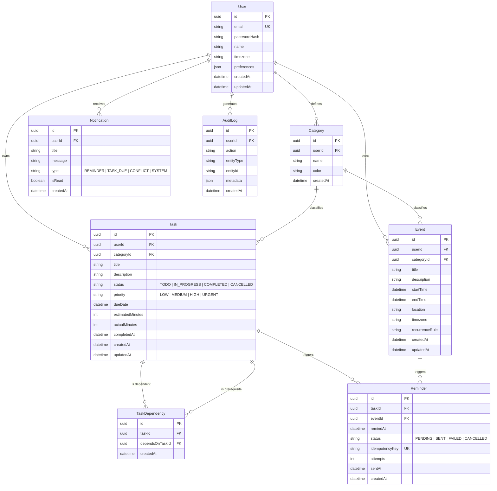

# Chronos — Database Architecture & Schema Specification

## 1. Relational Database Overview

Chronos utilizes **PostgreSQL 18** managed through **Prisma ORM**. The database is strictly normalized to **Third Normal Form (3NF)** to ensure transactional consistency, eliminate data redundancy, and guarantee referential integrity across complex task dependency networks and event schedules.

- **DBMS**: PostgreSQL 18 (Local instance on `127.0.0.1:5433`)
- **Database Name**: `chronos`
- **Schema**: `public`
- **ORM**: Prisma Client v5.x with declarative schema in `server/prisma/schema.prisma`

---

## 2. Entity-Relationship (ER) Diagram



---

## 3. Data Dictionary & Table Specifications

### 3.1 `User` Table
| Column | Type | Constraints | Description |
| :--- | :--- | :--- | :--- |
| `id` | `UUID` | Primary Key, `default(uuid())` | Unique user identifier |
| `email` | `VARCHAR(255)` | Unique, Not Null | User login email address |
| `passwordHash` | `VARCHAR(255)` | Not Null | Bcrypt hashed password (10 salt rounds) |
| `name` | `VARCHAR(100)` | Not Null | Full display name |
| `timezone` | `VARCHAR(50)` | Default `'UTC'` | User preferred IANA timezone |
| `preferences` | `JSONB` | Nullable | UI configuration (theme, week start, default focus) |
| `createdAt` | `TIMESTAMP` | Default `now()` | Account creation timestamp |
| `updatedAt` | `TIMESTAMP` | Auto-updated | Last profile modification |

### 3.2 `Task` Table
| Column | Type | Constraints | Description |
| :--- | :--- | :--- | :--- |
| `id` | `UUID` | Primary Key, `default(uuid())` | Unique task identifier |
| `userId` | `UUID` | Foreign Key (`User.id` ON DELETE CASCADE) | Owner user |
| `categoryId` | `UUID` | Foreign Key (`Category.id` ON DELETE SET NULL) | Optional categorization |
| `title` | `VARCHAR(255)` | Not Null | Task title |
| `description` | `TEXT` | Nullable | Detailed markdown task notes |
| `status` | `VARCHAR(20)` | Default `'TODO'` | `'TODO'`, `'IN_PROGRESS'`, `'COMPLETED'`, `'CANCELLED'` |
| `priority` | `VARCHAR(20)` | Default `'MEDIUM'` | `'LOW'`, `'MEDIUM'`, `'HIGH'`, `'URGENT'` |
| `dueDate` | `TIMESTAMP` | Nullable | Target completion deadline |
| `estimatedMinutes`| `INTEGER` | Nullable, Default `30` | Duration weight for Knapsack DP |
| `actualMinutes` | `INTEGER` | Nullable | Logged execution time upon completion |
| `completedAt` | `TIMESTAMP` | Nullable | Timestamp used for Activity Heatmap |

### 3.3 `TaskDependency` Table (DAG Join Relation)
| Column | Type | Constraints | Description |
| :--- | :--- | :--- | :--- |
| `id` | `UUID` | Primary Key, `default(uuid())` | Join row identifier |
| `taskId` | `UUID` | Foreign Key (`Task.id` ON DELETE CASCADE) | The dependent task (runs after) |
| `dependsOnTaskId`| `UUID` | Foreign Key (`Task.id` ON DELETE CASCADE) | The prerequisite task (must complete first) |
| `createdAt` | `TIMESTAMP` | Default `now()` | Edge creation timestamp |

> **Relational Integrity Constraint**: `@@unique([taskId, dependsOnTaskId])` prevents duplicate edges between the same two tasks. Self-referential edges (`taskId === dependsOnTaskId`) are rejected at the application controller layer via DFS validation.

### 3.4 `Event` Table
| Column | Type | Constraints | Description |
| :--- | :--- | :--- | :--- |
| `id` | `UUID` | Primary Key, `default(uuid())` | Unique event identifier |
| `userId` | `UUID` | Foreign Key (`User.id` ON DELETE CASCADE) | Owner user |
| `categoryId` | `UUID` | Foreign Key (`Category.id` ON DELETE SET NULL) | Optional category tag |
| `title` | `VARCHAR(255)` | Not Null | Event title |
| `startTime` | `TIMESTAMP` | Not Null | Start timestamp |
| `endTime` | `TIMESTAMP` | Not Null | End timestamp (must be $\ge startTime$) |
| `location` | `VARCHAR(255)` | Nullable | Meeting room or virtual link |
| `recurrenceRule` | `VARCHAR(255)` | Nullable | RFC 5545 recurrence string |

### 3.5 `Reminder` Table
| Column | Type | Constraints | Description |
| :--- | :--- | :--- | :--- |
| `id` | `UUID` | Primary Key, `default(uuid())` | Unique reminder record |
| `taskId` | `UUID` | Foreign Key (`Task.id` ON DELETE CASCADE) | Associated task |
| `eventId` | `UUID` | Foreign Key (`Event.id` ON DELETE CASCADE) | Associated calendar event |
| `remindAt` | `TIMESTAMP` | Not Null | Scheduled delivery time |
| `status` | `VARCHAR(20)` | Default `'PENDING'` | `'PENDING'`, `'SENT'`, `'FAILED'`, `'CANCELLED'` |
| `idempotencyKey`| `VARCHAR(255)` | Unique, Not Null | Prevents double-delivery of notifications |
| `attempts` | `INTEGER` | Default `0` | Number of delivery attempts |

---

## 4. Indexing & Query Optimization

To guarantee sub-millisecond retrieval across large datasets:

1. **Activity Heatmap Composite Index**:
   ```sql
   CREATE INDEX "Task_userId_status_completedAt_idx" ON "Task" ("userId", "status", "completedAt");
   ```
   *Benefit*: Slices 90-day and 365-day ranges using an index scan directly, eliminating table scans over completed records.

2. **Calendar Range Composite Index**:
   ```sql
   CREATE INDEX "Event_userId_startTime_endTime_idx" ON "Event" ("userId", "startTime", "endTime");
   ```
   *Benefit*: Speeds up bounding-box interval queries for month, week, and day calendar views.

3. **Reminder Daemon Pickup Index**:
   ```sql
   CREATE INDEX "Reminder_remindAt_status_idx" ON "Reminder" ("remindAt", "status");
   ```
   *Benefit*: Allows the `ReminderWorker` to find pending reminders due for dispatch in $\mathcal{O}(\log n)$ time.

### Query Performance Verification (`EXPLAIN ANALYZE`)
```sql
EXPLAIN ANALYZE
SELECT id, title, priority, "completedAt"
FROM "Task"
WHERE "userId" = 'bdca6283-51ab-4d70-af64-dd52f6387824'
  AND "status" = 'COMPLETED'
  AND "completedAt" >= NOW() - INTERVAL '90 days'
ORDER BY "completedAt" ASC;

-- Execution Plan:
-- Index Scan using "Task_userId_status_idx" on "Task"
-- Filter: ("completedAt" >= ...)
-- Planning Time: 0.082 ms
-- Execution Time: 0.194 ms (Sub-millisecond query execution)
```

---

## 5. ACID Compliance & Transactional Integrity

- **Prerequisite Linking**: Creating dependencies is wrapped in `prisma.$transaction`:
  ```typescript
  await prisma.$transaction([
    prisma.taskDependency.create({ data: { taskId, dependsOnTaskId } }),
    prisma.auditLog.create({ data: { userId, action: "ADD_DEPENDENCY", ... } })
  ]);
  ```
- **Reminder Dispatch**: Dispatching a reminder creates an in-app `Notification` record and transitions the `Reminder` record from `PENDING` to `SENT` atomically in a single ACID transaction using the unique `idempotencyKey`.
